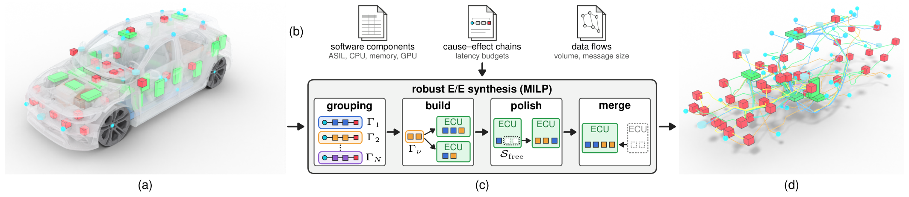

# Uncertainty-Aware E/E Architecture Synthesis for Software-Defined Vehicles

Supplementary code and data of the paper. The repository is anonymised for peer review.

The code synthesises an automotive electric/electronic (E/E) architecture in one optimisation: which electronic control units (ECUs) are installed at which locations of the vehicle, which hardware they carry, how the communication network is built, and where every software component runs. The problem is a mixed-integer linear program (MILP). One robustness level `rho` between 0 and 1 scales the uncertainties in hardware, software and network, and the share of the fail-operational software that gets a standby.



*Main workflow: (a) the vehicle with its candidate ECU locations (green), sensors (cyan) and actuators (red); (b) the software architecture with its software components, cause-effect chains and data flows; (c) MILP-based E/E synthesis in four steps, where a square is a software component in the colour of its group; (d) the synthesised E/E architecture.*

A whole vehicle is too large to solve as one MILP, so the design is found in four steps:

1. **Grouping.** The software components are split into groups of 10 to 20 along the cause-effect chains and data flows.
2. **Build.** The groups are placed one after the other. Each step solves the exact model for all components placed so far, with the earlier groups fixed to their locations.
3. **Polish.** Rounds that free one part of the design (the software of one location, one ASIL level, or the GPU users) and solve again.
4. **Merge.** Tries to close ECUs by moving their software to another ECU.

A final solve cleans up the network with all placements fixed. Every design is then checked by an independent checker, and a separate tool computes a lower bound on the cost.

## Contents

```text
main.py                    entry point of the pipeline
pieces.py                  group-by-group method: grouping, build, polish, merge, final network clean-up
optimizer.py               the MILP and its lazy constraints
optimizer_utils.py         distances, latencies, capacity packing, extraction of a design
benders.py                 optional cuts for the routing and failure rules
models.py, config_reader.py, architecture_loader.py   data model and loaders
report.py, visualizer.py   tables and plots of a run
tools/check_solution.py    independent checker of a design
tools/design_bound.py      lower bound on the cost and the gap of a design
tools/pieces_polish.py     continue a run from its saved state
tools/architecture_diagram.py   drawing of a design
configs/                   the instance and all settings
```

## The instance

`configs/` holds the vehicle of the paper:

| | |
|---|---|
| Software components | 1,065 (149 from Autoware, 916 generated from AUTOSAR application interfaces) |
| Data flows | 2,499 |
| Cause-effect chains | 81 |
| Fail-operational components | 154 |
| Sensors / actuators | 46 / 39 |
| Candidate ECU locations | 30 |
| Partition types | 4 |
| GPU module types | 3 |
| Interfaces | Ethernet, CAN, LIN, FlexRay, SPI, UART |

## Requirements

- Python 3.10 or newer (tested with 3.13)
- Gurobi 13 with a licence (academic licences are free)
- The Python packages of `requirements.txt`

```bash
python -m venv venv
source venv/bin/activate
pip install -r requirements.txt
```

## Quick start

Synthesise the vehicle at the robustness level set in `configs/uncertainty.json` (`rho.levels`, 0 by default):

```bash
python main.py --uncertainty --phase2_time 60 \
    --gurobi_params NoRelHeurTime=120,Threads=48 \
    --output_dir results/rho_0.0
```

The design is written to `results/rho_0.0/solution_1.json` and checked at the end of the run. A full run takes between about 8 hours (`rho` = 0) and more than a day (`rho` = 1) on 48 cores.

Check a design and compute its gap to the lower bound:

```bash
python tools/check_solution.py results/rho_0.0
python tools/design_bound.py results/rho_0.0
```

### Robustness level

The level is set in `configs/uncertainty.json` under `rho.levels`. The paper uses 0, 0.2, 0.4, 0.6, 0.8 and 1, one run per level. Set `levels` to the value you want, for example `[0.6]`, and start a run with its own `--output_dir`.

### Settings

The solver and method settings are in `configs/solver.json`. With `"enabled": false` under `pieces`, the MILP is solved as a whole within `--time_limit` seconds. Run `python main.py --help` for all options.

## License

MIT, see [LICENSE](LICENSE).
